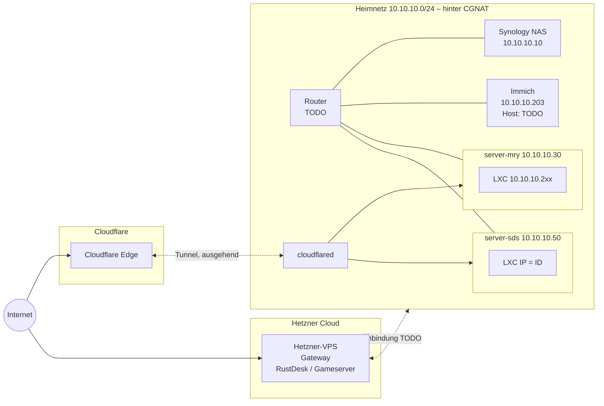

# Homelab – Übersicht

Zentrale Übersicht über Hardware, IP-Adressen und Dienste.
Details zum Zugriff von außen: [netzwerk.md](netzwerk.md).

> Einträge mit **TODO** sind noch nicht bestätigt bzw. fehlen noch.

## Netz

| Eigenschaft     | Wert                      |
|-----------------|---------------------------|
| Heimnetz        | `10.10.10.0/24`           |
| Gateway/Router  | TODO                      |
| DNS im LAN      | TODO                      |
| Internetzugang  | CGNAT (keine öffentliche IPv4) – siehe [netzwerk.md](netzwerk.md) |

## Server

| Name         | Typ               | IP            | Aufgabe                         |
|--------------|-------------------|---------------|---------------------------------|
| server-mry   | Proxmox VE        | `10.10.10.30` | Hypervisor (LXC/VMs)            |
| server-sds   | Proxmox VE        | `10.10.10.50` | Hypervisor (LXC/VMs)            |
| Synology NAS | Synology DSM      | `10.10.10.10` | Speicher, TODO: Freigaben/Backups |
| Hetzner-VPS  | VPS (extern)      | `<VPS_PUBLIC_IP>` | Gateway für RustDesk und Gameserver |

## IP-Schema für LXC-Container

| Host       | Bereich         | Regel                                   | Beispiel |
|------------|-----------------|-----------------------------------------|----------|
| server-mry | `10.10.10.2xx`  | letzte Stelle(n) aus der Container-ID   | TODO     |
| server-sds | `10.10.10.<ID>` | IP = Container-ID                       | TODO     |

> **TODO:** Regel für server-mry genau festhalten (z. B. CT `103` → `.203`
> oder CT `203` → `.203`?) und klären, wie Überschneidungen mit server-sds
> vermieden werden (dort IP = ID, IDs ≥ 100 laut Proxmox).

## Dienste

| Dienst | Host        | CT/VM-ID | Typ  | IP              | Port | Zugriff extern |
|--------|-------------|----------|------|-----------------|------|----------------|
| Immich | TODO        | TODO     | TODO | `10.10.10.203`  | TODO | TODO           |

Weitere Dienste werden ergänzt, sobald die Angaben vorliegen.

## Netzstruktur

> Das Diagramm zeigt die Zielstruktur. Wo cloudflared läuft und wie der
> VPS genau angebunden ist, steht als TODO in [netzwerk.md](netzwerk.md).
