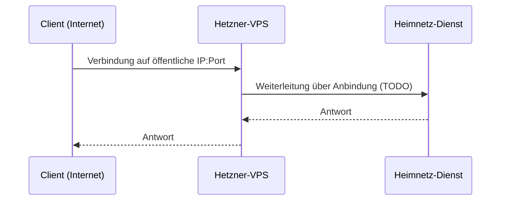

# Netzwerk und Zugriff

Wie das Homelab von außen erreichbar ist – und warum es so gelöst ist.

## Ausgangslage: CGNAT

Der Internetanschluss liegt hinter **Carrier-Grade NAT**. Es gibt keine
öffentliche IPv4-Adresse, Portweiterleitungen am Router funktionieren daher
nicht. Jeder Zugriff von außen läuft über eine **ausgehende** Verbindung
aus dem Heimnetz zu einem Dienst mit öffentlicher Adresse.

| Weg          | Wofür                                 | Richtung               |
|--------------|---------------------------------------|------------------------|
| cloudflared  | Web-Dienste (HTTP/HTTPS) öffentlich   | Heimnetz → Cloudflare  |
| Tailscale    | Admin-Zugriff, privates Netz          | Mesh (WireGuard)       |
| Hetzner-VPS  | RustDesk, Gameserver (TCP/UDP)        | Internet → VPS → Heimnetz |

## cloudflared (Cloudflare Tunnel)

Für Web-Dienste, die über eine Domain erreichbar sein sollen.

| Eigenschaft      | Wert                          |
|------------------|-------------------------------|
| Läuft auf        | TODO (CT/VM, IP)              |
| Domain           | `<DOMAIN>`                    |
| Tunnel-Token     | `<CLOUDFLARE_TUNNEL_TOKEN>` (nur in `.env`) |
| Cloudflare Access| TODO (ja/nein, für welche Dienste) |

Veröffentlichte Hostnamen:

| Hostname            | Ziel intern | Dienst |
|---------------------|-------------|--------|
| TODO                | TODO        | TODO   |

Hinweis: Cloudflare begrenzt Uploads im Free-Plan auf 100 MB pro Request –
relevant für Dienste mit großen Uploads (z. B. Immich).

## Tailscale

Privater Zugriff auf das Heimnetz ohne öffentliche Freigabe.

| Eigenschaft        | Wert                          |
|--------------------|-------------------------------|
| Subnet-Router      | TODO (welcher Host, `10.10.10.0/24` beworben?) |
| Exit-Node          | TODO                          |
| MagicDNS           | TODO                          |
| Auth-Key           | `<TAILSCALE_AUTHKEY>` (nur in `.env`) |

Geräte im Tailnet:

| Gerät        | Tailscale-IP   | Rolle  |
|--------------|----------------|--------|
| TODO         | `100.x.y.z`    | TODO   |

## Hetzner-VPS als Gateway

Der VPS hat eine öffentliche IP und leitet Verbindungen für Dienste, die
kein HTTP sprechen, ins Heimnetz weiter.

| Eigenschaft       | Wert                       |
|-------------------|----------------------------|
| Öffentliche IP    | `<VPS_PUBLIC_IP>`          |
| Betriebssystem    | TODO                       |
| Anbindung Heimnetz| TODO (Tailscale? WireGuard? Weiterleitung per iptables/nftables, socat, Proxy?) |
| Firewall          | TODO (Hetzner Cloud Firewall und/oder ufw/nftables) |

### RustDesk

| Eigenschaft     | Wert                         |
|-----------------|------------------------------|
| hbbs/hbbr läuft | TODO (auf dem VPS selbst oder im Heimnetz?) |
| Ports           | TODO (Standard: 21115–21117/TCP, 21116/UDP; Web-Client 21118–21119/TCP) |
| Public Key      | `<RUSTDESK_PUBLIC_KEY>`      |

### Gameserver

| Spiel | Läuft auf (CT/VM, IP) | Port(s) / Protokoll | Weiterleitung VPS |
|-------|-----------------------|---------------------|-------------------|
| TODO  | TODO                  | TODO                | TODO              |

## Ablauf einer Verbindung

